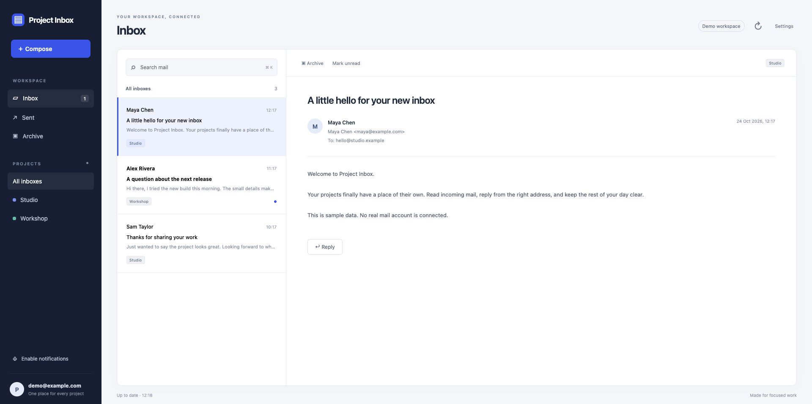

# Project Inbox

A lightweight, open source email client for multiple Resend accounts. One local browser app for reading, writing, and replying to mail across your projects.

No hosted account, Google sign-in, Docker, or public webhook endpoint. Your computer connects to Resend when you open the app. This is an early release being tested with real project email.

## Run locally

Requires **Node.js 22.16 or newer**.

```sh
npx --yes project-inbox
```

The command starts a loopback-only local process and opens your browser. Add a project name, mailbox address, and **full-access Resend API key** in Settings. Repeat for your other projects. Saved accounts remain available after restarts.

Try the interface without connecting email:

```sh
npx --yes project-inbox --demo
```

The demo uses sample messages in memory and cannot send or save real credentials.

The client is published on npm. Source is also available from GitHub.

## Set up everything with one command

Project Inbox is two small npm packages: the **app** (`project-inbox`, your inbox and calendar) and the **MCP server** (`project-inbox-mcp`, which lets Claude and Codex use it). You never install either globally. One command connects your AI tools and opens the app:

```sh
npx --yes project-inbox setup
```

It looks for Claude Code, Codex and Claude Desktop on your computer, asks before adding Project Inbox to each one, and then starts the app as usual. Choose specific tools with `--for`, for example `--for codex` or `--for claude` (Claude Code and Claude Desktop), or add `--yes` to skip the questions. Tools that already have it are left alone, and Claude Desktop's config is backed up first. Restart a tool after it is added.

Day to day, start the app with `npx --yes project-inbox` and keep it running, since the MCP server talks to it. The MCP finds the app by itself on the default port 8787, or on any port you chose with `--port`. To set it up by hand, see the [MCP README](packages/mcp/README.md).

## Task calendar

The **Task calendar** in the sidebar shows what was done each day: posts, outreach emails, listings and profiles, each with a status (planned, drafted, sent, published, backlink verified, withdrawn, failed), the destination, a result link and notes. Entries live in the same local SQLite database as your mail. Use **Import post-log.csv** to backfill from a CSV with the columns `date, game, destination, status, result_url, account, notes`; importing the same file again updates entries instead of duplicating them. Agents record work as it happens through the MCP `log_task` and `update_task` tools, and each task keeps a timestamped history. Scheduled tasks can be imported from Codex (opt-in, names and schedules only) or saved by Claude through `sync_schedules`; a scheduled day shows whether a run was logged for it.

## Agent integration

[Project Inbox MCP](packages/mcp/README.md) connects agents to the running local app for account discovery, sync, message search, reading, composing drafts, and sending authorized messages. It uses the same local settings without returning Resend keys to the agent. Requires Project Inbox 0.2.0 or later for the task calendar tools.

## What it does

- Unified inbox with separate project views, Inbox, Sent, and Archive.
- Syncs received and sent email through Resend's APIs. Imports history in bounded pages and resumes interrupted imports.
- Compose and reply from the selected project's address.
- Font family, font size, bold, italic, underline, lists, and links. Sends plain text plus sanitized HTML.
- Read/unread state, archive, Trash, Restore, search, and incoming attachment downloads.
- Permanent local deletion removes cached content and compacts SQLite. A small deletion marker prevents re-import; Resend's copy is unaffected.
- Save feedback locally, export it, or open a prefilled public GitHub issue for review and submission.
- Optional desktop notifications while the browser app is open and active.
- SQLite persistence and encrypted storage for Resend API keys.



## Resend setup

Your sender domain must be verified in Resend. To receive mail here, enable receiving for your domain and configure the **exact MX record shown by Resend** with your DNS provider. A forwarding-only route to Gmail will not populate this inbox.

Use one project entry per mailbox address. Entries can use different Resend accounts. If several addresses share one Resend account, use separate project IDs and the appropriate account's key. The client filters messages by the configured address.

Resend supplies the mail transport and its own quotas and retention apply. Project Inbox is a client, not an SMTP/IMAP server. It does not connect to personal Gmail or other mail providers in this release.

[Resend receiving guide](https://resend.com/docs/dashboard/receiving/custom-domains) · [Receiving API](https://resend.com/docs/api-reference/emails/list-received-emails)

## Where data lives

By default, private data lives in `~/.project-inbox/`:

- `inbox.sqlite`: cached messages, settings, read state, and encrypted account credentials.
- `credentials.key`: a generated local encryption key. Keep this with the database in private backups.

API keys are encrypted using AES-GCM and are never returned to browser settings. They are decrypted in the local Node process only when needed for provider requests. The encryption key is stored on the same computer, so this protects a copied database without its key; it does not protect against someone who controls your computer. Cached email content itself is not encrypted by the app. Use your operating system's disk encryption for that.

The listener binds to `127.0.0.1`, checks the request host, and requires same-origin JSON for changes. There is deliberately no sign-in screen. Do not expose or reverse-proxy this local app onto a public network.

Mail HTML opens in an isolated frame with scripts, forms, and remote content blocked. No analytics or third-party UI assets are loaded.

## Options

```sh
project-inbox --port 8798
project-inbox --no-open
project-inbox --demo
```

From a checkout:

```sh
npm ci
npm start
```

An ignored `.env` file is optional; copy `.env.example` if you want to change the port, data directory, or encryption key. Do not change an existing encryption key without migrating saved credentials. Never commit populated environment files or your data directory.

Keep the process running while using the browser app. Closing the browser does not delete data; stopping the Node process makes the local URL unavailable until restarted. Mail continues to reach Resend while the client is closed and can be synced later, subject to the provider's retention. Fully closed apps do not display notifications.

## Development

```sh
npm ci
npm test
npm run check
npm run dev
```

Modules separate HTTP routing (`src/app.js`), provider access and credential handling (`src/core.js`), incremental sync (`src/sync.js`), sending (`src/send.js`), HTML sanitization (`src/format.js`), storage (`src/sqlite.js`), and the local launcher (`bin/cli.js`). The browser client has no frontend framework or build step.

GitHub Actions checks Windows, macOS, and Linux. The publishing workflow runs on a published release or manual dispatch and uses npm trusted publishing. See [release instructions](docs/releasing.md).

## Current limits

This is a local Resend client, not a replacement for every feature of a traditional mail suite. Outgoing attachments, CC/BCC, saved drafts across browser restarts, calendar integration, mobile sync, and closed-app notifications are not included yet. Search covers cached subject/sender/body; message bodies are fetched on opening, so unvisited body text may not be searchable. Archives, read state, and deletions are local and do not alter Resend's records.

MIT licensed. Issues and small, focused contributions are welcome.
